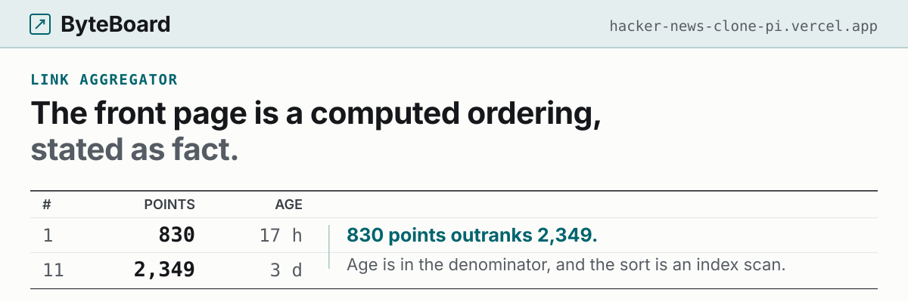
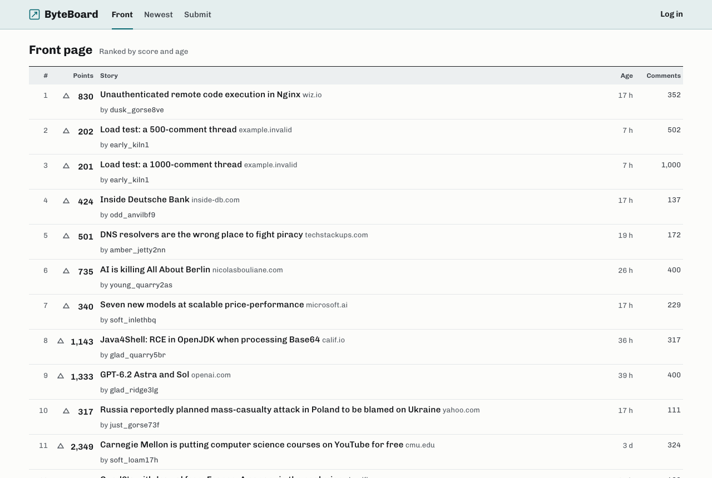
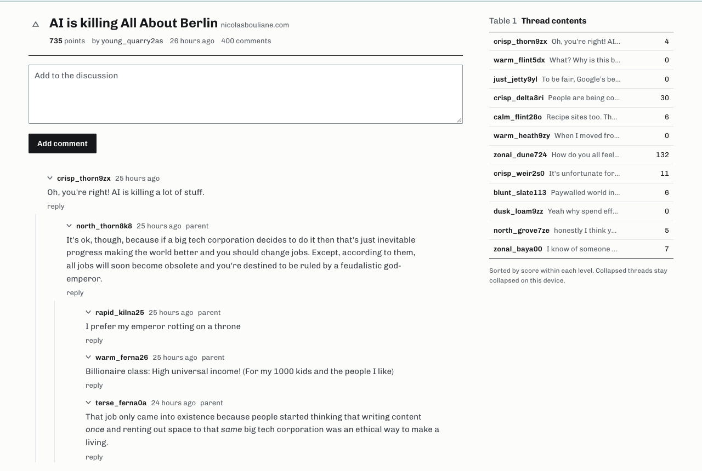

<p align="center">
  
</p>

<p align="center">
  <strong><a href="https://hacker-news-clone-pi.vercel.app/">hacker-news-clone-pi.vercel.app</a></strong>
  &nbsp;·&nbsp; Next.js 16 &nbsp;·&nbsp; Postgres &nbsp;·&nbsp; Prisma &nbsp;·&nbsp; Clerk
</p>

A Hacker News clone, built to work through two problems that have real answers rather than
preferences: **a time-decay ranking Postgres cannot index**, and **arbitrary-depth comment trees
loaded in one query**. Everything renders on the server; nothing is fetched by the browser.

## The front page



Ranked by score and age, thirty to a page. The ordering is the product, so it is stated as a
column of figures rather than implied by sequence.

## A thread



Four hundred comments, nested to arbitrary depth, in one query. The aside is a contents table —
click a name for the person, the clip to jump to the comment.

## The ranking

```
score = (points − 1) / (age_hours + 2) ^ 1.8
```

Computed **only in SQL**, by `refresh_ranked_posts()` on `pg_cron` every minute, over a 7-day
candidate window, into `RankedPost(score DESC)`. There is no second copy of the formula in
TypeScript — a duplicate would be a thing that can disagree with the order on screen.

The problem is that every score changes every minute, because the denominator is age. So the table
is rebuilt wholesale inside one statement, which is also what keeps readers from ever seeing it
empty. Measured against 1,380 stories, 977 of them inside the window:

| | Statement | DB execution | Plan |
|---|---|---|---|
| Score and sort at read time | inline in SQL, `LIMIT 30` | 23.25 ms | Seq Scan + top-N heapsort |
| Read a materialised score | index scan on `RankedPost` | **0.26 ms** | Index Scan |

**The 91× is not the reason it won.** A round trip to Supabase is ~105 ms and the query inside it
costs 0.26 ms, so the saving is worth about 20 ms of a 135 ms request. The real reason is that
`computedAt` only exists if something computed it — an inline score is `now()` by construction and
therefore can never be stale, which sounds like a feature and is actually the absence of a
measurement.

### The bottleneck was somewhere else

Materialising made the page *slower* at first, 320 ms against 237 ms. Not the query:

| Prisma `relationLoadStrategy` | Statements | Time |
|---|---|---|
| `query` (the default) | 3 | 320 ms |
| `join` | **1** | **114 ms** |

Prisma's default issues one statement per relation level, sequentially. `RankedPost → Post → User`
is three statements, each paying a full round trip to do a fraction of a millisecond of work. Round
trips, not query cost, are the only thing worth optimising here.

## The comment trees

`parentId` is the truth; a materialised `path` is the index. Each segment is an id zero-padded to
ten digits and joined with `.`, which makes lexicographic order equal numeric order — so
`ORDER BY path` *is* depth-first display order and Postgres returns the rows already arranged.

```sql
select * from "Comment" where "postId" = $1 order by path
```

One query, no recursive CTE, no N+1, assembled in a single pass. Drop the padding and comment 10
sorts before comment 9, silently reordering every thread.

## Run it locally

```bash
pnpm install
cp .env.example .env     # then fill in Supabase and Clerk credentials
pnpm db:deploy           # migrations, incl. the pg_cron ranking and karma jobs
pnpm db:seed             # or pnpm db:seed:hn to import real stories from Algolia
pnpm dev
```

`.env.example` documents which Supabase pooler each URL needs and why they differ — migrations need
a real session, the app wants the transaction pooler. Getting that wrong fails in ways that read
like network errors.

```bash
pnpm test         # 72 unit tests, plus 12 database-backed ones that
                  # skip unless a seeded database is reachable
pnpm lint
pnpm verify:rls   # asserts row-level security is on every table
```

## How it is built

| | |
|---|---|
| Framework | Next.js 16 App Router, React 19, TypeScript strict |
| Rendering | Server Components throughout; every route dynamic, streaming behind Suspense |
| Styling | Tailwind v4, CSS-first, one accent colour |
| Data | Prisma 7 with the `pg` driver adapter, Supabase Postgres, own schema |
| Auth | Clerk 7 owns identity; the username is claimed separately at `/welcome` |
| Interactivity | Server Actions; votes and submissions are plain form POSTs |
| Tests | Vitest |

Interaction is deliberately thin. Voting, replying, flagging, submitting and moderating are forms
posting to Server Actions, with optimistic score updates read from the in-flight `FormData` rather
than from client state. Thirteen client components in total, and the listing rows are not among
them.

Keyboard: <kbd>j</kbd> <kbd>k</kbd> move, <kbd>u</kbd> vote, <kbd>x</kbd> collapse, <kbd>?</kbd> for
the rest.

## Notes

- Stories, people and comments on the live site are **synthetic sample data**. Real Hacker News
  titles and links are imported via Algolia; the authors are anonymised to generated names.
- Ranking parameters live in `src/lib/config.ts`: gravity 1.8, a 7-day window, a one-minute
  recompute, thirty rows a page.
- [`MILESTONES.md`](./MILESTONES.md) is the build log: what each milestone measured and what it got
  wrong first. It is written up in detail through M10 and trails the code, which reached M15.
